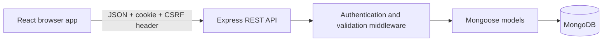
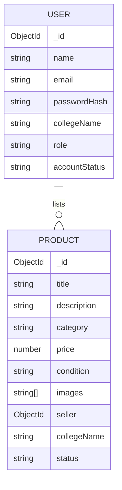

# CampusCart

CampusCart is a college-focused marketplace for students to discover and list pre-owned study and campus items. The implementation includes student authentication, listings, saved items, private enquiries, reports, profile editing, and role-protected administration.

## Current implementation status

- [x] React/Vite and Express project setup
- [x] MongoDB/Mongoose connection with startup checks
- [x] Student registration and login using bcrypt and an HttpOnly JWT cookie
- [x] SameSite cookie plus CSRF-token checks for state-changing API requests
- [x] Product create, browse, detail, edit, soft-delete, and mark-as-sold API workflows
- [x] Database-backed search, category/condition/price filters, sorting, and pagination
- [x] Responsive React pages for browsing, account access, listing creation, and own listings
- [ ] Hosted image uploads (current listing form accepts hosted image URLs only)
- [x] Persistent wishlists, private enquiries, listing reports, and administrator moderation APIs
- [x] React pages for saved finds, enquiries, and admin moderation
- [x] Student profile editing with role/account status protected on the API
- [x] Local demo product catalogue when the API is unreachable or MongoDB returns `503`
- [ ] Automated API/UI tests and deployment

Items above are marked complete as implementation work, not as production verification. The frontend build and MongoDB-offline demo flow were verified locally. No MongoDB connection is configured, so persistent database/authentication flows have not been verified.

## Technology and architecture

- Frontend: React, Vite, React Router, plain CSS
- Backend: Node.js, Express, Mongoose, Zod
- Database: MongoDB (Atlas or local)
- Authentication: bcryptjs password hashes, short-lived JWT in an HttpOnly cookie, CSRF token header



The browser calls the frontend service module, which sends a request to `/api`. Express validates the request and verifies identity/ownership, Mongoose reads or writes the database, and the API returns JSON for React to render.

### Data model



## Folder structure

```text
CampusCart/
  client/
    src/
      components/
      context/
      pages/
      services/
      styles/
  server/
    src/
      config/
      middleware/
      models/
      routes/
```

## Requirements and setup

Install a current Node.js LTS release (npm is included) and have a MongoDB database available. The app does not include credentials or automatically seed production data.

1. Open two terminals at the project root.
2. In `server/`, copy `.env.example` to `.env` with `Copy-Item .env.example .env`.
3. Generate a strong server-only JWT secret in PowerShell with `node -e "console.log(require('crypto').randomBytes(48).toString('hex'))"` and paste the output into `JWT_SECRET` in `server/.env`. Keep it private; never put it in `client/.env`.
4. For local MongoDB, set `MONGODB_URI=mongodb://127.0.0.1:27017/campuscart`. For Atlas, paste your own connection string, in the form `mongodb+srv://<db-user>:<db-password>@<cluster-host>/<database-name>?retryWrites=true&w=majority`, into `MONGODB_URI` in `server/.env`. Replace every placeholder and URL-encode special characters in the database password.
5. Set `CLIENT_URL=http://localhost:5173`.
6. In the server terminal, run `npm start` (or `npm run dev` while developing).
7. In `client/`, copy `.env.example` to `.env` with `Copy-Item .env.example .env`, then run `npm run dev`.
8. Open the local URL printed by Vite.

Backend startup checks report missing configuration without printing secret values. If MongoDB is not configured or unavailable, the API still starts, but database-dependent requests return `503`. The home page then displays the clearly labeled local demo catalogue, which is not persisted. Authentication needs both a connected database and a server-only `JWT_SECRET` of at least 32 characters. Do not commit `.env` files.

### Environment variables

`server/.env.example`:

| Variable | Purpose |
| --- | --- |
| `PORT` | Express listening port (defaults to 5000) |
| `MONGODB_URI` | MongoDB connection string |
| `JWT_SECRET` | Secret used to sign authentication cookies (minimum 32 characters) |
| `CLIENT_URL` | Exact frontend origin allowed by CORS |
| `NODE_ENV` | `development` or `production` |

`client/.env.example`:

| Variable | Purpose |
| --- | --- |
| `VITE_API_URL` | API base URL, including `/api` |

## MVP features and usage

Guests can browse and search available listings. A student can register, log in, create and edit their own listing, mark it sold, and remove it. Public registration always creates a student account; the API never accepts a role from the registration payload.

Product categories: Textbooks and Notes; Calculators and Electronics; Lab Equipment; Stationery; Hostel Essentials; Clothing and Accessories; Sports Equipment; Other.

Product images are currently entered as hosted image URLs. No image-upload integration is configured or implied. Add upload support only after choosing a provider and configuring its server-side credentials.

When the public product API is unreachable or returns `503` because MongoDB is unavailable, the home page and demo product detail pages use a separate local catalogue in `client/src/data/demoProducts.js`. The UI labels these clearly as demo examples; they are not stored in MongoDB. Searches, category/condition/price filters, and sorting also apply to the local demo list. Wishlist, enquiry, report, and account actions remain unavailable for demo listings until MongoDB is connected.

## REST API

All routes are prefixed with `/api`. JSON success responses use `{ data: ... }`; errors use `{ error: { message, details? } }`.

| Method | Endpoint | Access | Purpose |
| --- | --- | --- | --- |
| `GET` | `/health` | Public | API liveness |
| `GET` | `/api/auth/csrf` | Public | Set/return CSRF token |
| `POST` | `/api/auth/register` | Public, rate limited | Register student |
| `POST` | `/api/auth/login` | Public, rate limited | Sign in |
| `POST` | `/api/auth/logout` | Public | Clear auth cookie |
| `GET` | `/api/auth/me` | Signed in | Current safe profile |
| `PATCH` | `/api/auth/me` | Signed in | Update name and college only |
| `GET` | `/api/products` | Public | Search/filter/sort/page available listings |
| `GET` | `/api/products/:id` | Public | Product details |
| `POST` | `/api/products` | Signed in | Create a listing |
| `PATCH` | `/api/products/:id` | Owner | Edit a listing |
| `PATCH` | `/api/products/:id/status` | Owner | Mark available/reserved/sold |
| `DELETE` | `/api/products/:id` | Owner | Soft-remove own listing |
| `GET` | `/api/wishlist` | Signed in | Read saved, available listings |
| `POST` | `/api/wishlist/:productId` | Signed in | Save an available listing |
| `DELETE` | `/api/wishlist/:productId` | Signed in | Remove a saved listing |
| `POST` | `/api/enquiries` | Signed in | Send a private message to an available listing's seller |
| `GET` | `/api/enquiries/sent` | Signed in | List the current user's sent enquiries |
| `GET` | `/api/enquiries/received` | Signed in | List the current user's received enquiries |
| `PATCH` | `/api/enquiries/:id/status` | Enquiry seller | Update enquiry response status |
| `POST` | `/api/reports` | Signed in | Report a listing (one report per student/listing) |
| `GET` | `/api/reports/mine` | Signed in | Read own submitted reports |
| `GET` | `/api/admin/stats` | Admin | Read live marketplace counts |
| `GET` | `/api/admin/users` | Admin | Search and read safe, paginated user records |
| `PATCH` | `/api/admin/users/:id/status` | Admin | Suspend/reactivate a student account |
| `GET` | `/api/admin/products` | Admin | Search and read listings for moderation |
| `PATCH` | `/api/admin/products/:id/moderation` | Admin | Remove/restore a listing |
| `GET` | `/api/admin/reports` | Admin | Read reports |
| `PATCH` | `/api/admin/reports/:id` | Admin | Review/resolve a report |

Product query parameters: `search`, `category`, `condition`, `minPrice`, `maxPrice`, `sort` (`newest`, `price-asc`, `price-desc`), `page`, and `limit` (maximum 40).

State-changing authenticated requests require the `X-CSRF-Token` header returned by `/api/auth/csrf`. The frontend client handles this automatically.

## Security notes

- Passwords are hashed and never returned by user APIs.
- JWT is stored in an HttpOnly cookie and is not put in browser local storage.
- CORS allows only the configured frontend origin and credentialed requests.
- Helmet, login/registration rate limits, server-side Zod validation, bounded pagination, and safe search expression escaping are enabled.
- Product updates use an allowlist and ownership checks; removals are soft-deletes.
- Wishlist entries are scoped to their owner; enquiry content is returned only to its buyer and seller; reports are private to their reporter and administrators.
- Administrator APIs verify the server-side user role. Public registration cannot assign privileged roles. For local development, provision an administrator by changing a trusted local MongoDB user record directly; never expose an admin-promotion endpoint.
- Do not deploy until using HTTPS, a production-strength secret, a least-privilege database user, and a properly restricted Atlas network policy.

## Testing and build commands

From `server/`: `npm run dev`, `npm start`.

From `client/`: `npm run dev`, `npm run build`, `npm run preview`.

Automated API and frontend test suites are not implemented yet. The frontend production build completed successfully with Node.js 24.22.1 and Vite 6.4.5. Database-backed API flows were not tested because MongoDB is not configured.

### Manual integration check

1. Start MongoDB, the server, and the Vite client.
2. Register two student accounts with different email addresses.
3. With the first account, create a listing and check it appears on the home page.
4. Search by part of its title, then try a category and price filter.
5. Open the listing, edit it as its seller, and mark it sold.
6. Confirm it no longer appears in the public available-listings results.
7. Sign in as the second account and verify that editing the first account's listing returns `403`.
8. From the second account, save a listing, send an enquiry, and report a listing; check saved items and sent enquiries.
9. Sign back into the seller account and verify received enquiries are private and can be responded to.
10. Refresh the browser and confirm the session remains available through the cookie.
11. Provision an admin role directly in a development database, sign in, and review the admin dashboard; verify a normal student is rejected by admin APIs.

## Deployment

Deployment has not been performed. Build the client with `npm run build`, host the `client/dist` output, deploy the Express server separately, set the production environment variables, and configure the exact frontend origin in `CLIENT_URL`. Use HTTPS and keep frontend and API on the same site where possible so the `SameSite=Lax` cookie policy works. The client must be built with the deployed API URL. Configure the host to serve client route fallbacks for direct navigation.

No repository or live deployment URLs are available yet.

## MVP stories and acceptance checks

- As a guest, I can discover available campus listings by title and filters.
- As a student, I can securely register/login and publish a listing.
- As a seller, I can edit, mark sold, or remove only my own listing.
- As a visitor, I cannot see seller email addresses or modify listings.

Acceptance is pending database-backed runtime verification because MongoDB is not configured. The local catalogue was verified in the browser with eight demo products, working search/filter results, and product detail pages.

## Future work and known limitations

- Add automated API tests for ownership/role rules and frontend interaction tests.
- Add secure server-side image hosting, upload size/type validation, and cleanup.
- Add safe demo seed tooling and deployment-specific health/readiness checks.
- No college enrollment verification, payments, shipping workflow, or live deployment is implemented.

## GitHub workflow

No Git repository was present when work began. To initialize locally:

```sh
git init
git add .
git commit -m "Create CampusCart MVP foundation"
```

Create an empty repository on GitHub, then add its HTTPS/SSH URL as `origin` and push the chosen branch. Use feature branches for larger changes, pull before pushing, and resolve conflicts by reviewing the competing changes before committing. No repository was created, and no changes were committed or pushed.
